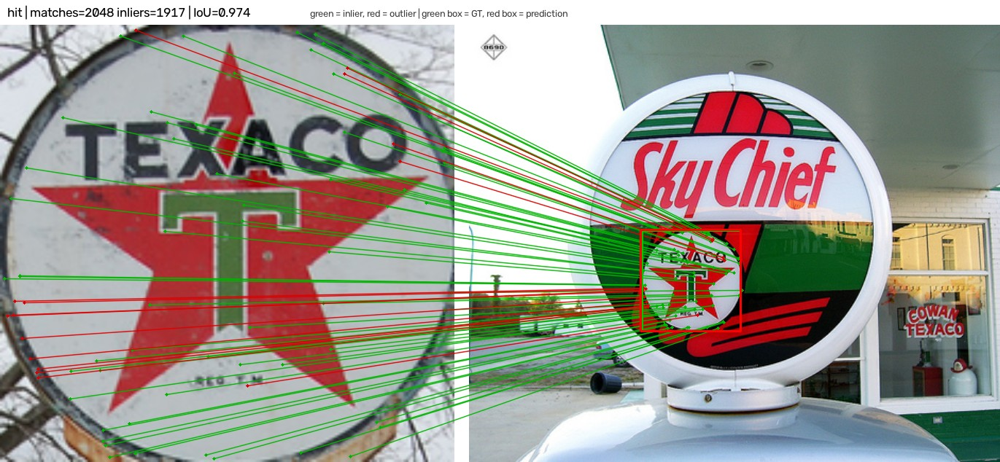

# One-Shot Instance Detection

Find **this exact instance** — a specific logo, person, or product — in RGB
query images, given a single reference image or crop.

This is **instance-level matching**, not category detection and not tracking.
The reference defines the instance; no class label is required. The benchmark is
training-free by default: released matcher weights, a fixed harness, and the same
evaluation for every model.

> **Status (November 2026).** Eight matchers are implemented. Results are
> available for FlickrLogos-32, RPC, and HPatches. A 200-query PRW subset is
> benchmarked; local matching collapses on full-frame person search, and the
> full PRW/RoMa runs are pending.

## How it works

```text
reference crop → keypoints / correspondences → match → RANSAC homography → box
```

| Aspect | Decision |
|---|---|
| Input | A reference image, or a crop of one specific instance |
| Output | A box for the same instance in a query image |
| Task | Instance-level matching |
| Modality | RGB only |
| Training | Pretrained weights; fine-tuning allowed, training from scratch is out of scope |

A single homography returns the dominant instance. Finding every occurrence
needs a multi-model step such as sequential RANSAC or proposal-then-verify.

## Quick start

Requirements: Python 3.12, [uv](https://docs.astral.sh/uv/), and a ROCm or CUDA
GPU. CPU works but is slow.

```bash
make rocm-wheels   # once on a fresh ROCm clone
make sync
make gpu           # expect device: cuda on ROCm

make data-flickr   # download and build the manifest
make bench         # run the box benchmark
```

Other benchmarks:

```bash
make hpatches                  # matcher validation
make bench-all                 # every dataset whose data is present
make bench-all MODELS="sift"   # quick pass
```

On WSL2, run `bash scripts/setup_wsl_rocm.sh` first. CUDA, CPU, and macOS setup
is covered in [`docs/rocm-setup.md`](docs/rocm-setup.md).

## Results

All runs use released weights and the same harness: 2,048 keypoints, a 0.75
ratio test for classical matchers, RANSAC at 3 px, and native image coordinates.
Columns are **not directly comparable** — FlickrLogos-32 and RPC are box AP@0.5
(RPC is category-level), while HPatches is matcher validation (HEA@3).

| Model | FlickrLogos-32 AP@0.5 | RPC AP@0.5 | HPatches HEA@3 |
|---|---:|---:|---:|
| RoMa | **0.656** | 0.361 | **0.841** |
| FlexGlue | 0.484 | **0.366** | 0.791 |
| LoFTR | 0.420 | 0.091 | 0.762 |
| SuperPoint + LightGlue | 0.420 | 0.175 | 0.748 |
| SIFT | 0.406 | 0.371 | 0.705 |
| ALIKED + LightGlue | 0.332 | 0.208 | 0.778 |
| AKAZE | 0.251 | 0.312 | 0.586 |
| ORB | 0.237 | 0.299 | 0.529 |

Rows are sorted by FlickrLogos-32 AP. The HPatches RoMa row uses the post-fix
balanced-sampling rerun. The full PRW run is pending.



*Left: reference crop. Right: query image. Green box = GT, red box =
prediction; green lines = RANSAC inliers, red lines = outliers. This pair has
2,048 matches, 1,917 inliers, and IoU 0.974.*

What stands out:

- RoMa is the strongest instance-level matcher, especially on small logos.
- FlexGlue is close behind at a fraction of the cost.
- Classical SIFT remains competitive on category-level RPC.
- The learned sparse models lead HPatches but not the retail data.

On a 200-query PRW subset, the best local matcher reaches AP@0.5 0.055:
full-frame person search is outside the local-matching regime. The full PRW
run and RoMa are pending.

Full per-dataset tables and figures are in the
[Week 2 devlog](docs/devnotes/week2-devnotes.md#5-results-by-dataset).

## Models

| Model | Family | Weights / code | Notes |
|---|---|---|---|
| SIFT | Classical | OpenCV | BF-L2, ratio 0.75 |
| ORB | Classical | OpenCV | BF-Hamming |
| AKAZE | Classical | OpenCV contrib | BF-Hamming |
| SuperPoint + LightGlue | Learned sparse | Vendored LightGlue | 2,048 keypoints, filter 0.1 |
| ALIKED + LightGlue | Learned sparse | Vendored LightGlue | 2,048 keypoints, filter 0.1 |
| LoFTR | Dense | Kornia outdoor weights | Long side capped at 640 px |
| RoMa v1 | Dense | Vendored official code | Balanced sampling, 560/864 resolution |
| FlexGlue | Sparse-to-dense | Vendored official code | ALIKED detector, DINOv3 descriptor, 640 px cap |

Notes:

- LightGlue runs with `flash=False` for ROCm compatibility; `--ratio` only
  affects the classical matchers.
- LoFTR and FlexGlue downscale large inputs to 640 px and map keypoints back.
- RoMa and FlexGlue vendored code keeps its upstream license; LoFTR comes from
  Kornia.
- Weights download on first use to `~/.cache/torch/hub/checkpoints`.

## Datasets

Four datasets cover three instance categories and one validation set.

| Dataset | Category | Protocol | Prepare |
|---|---|---|---|
| [FlickrLogos-32](https://www.uni-augsburg.de/en/fakultaet/fai/informatik/prof/mmc/research/datensatze/flickrlogos) | Logos | Box AP@0.5 | `make data-flickr` |
| [PRW](https://github.com/liangzheng06/PRW-baseline) | People | Box AP@0.5 | `make data-prw` |
| [RPC](https://arxiv.org/abs/1901.07249) | Products | Category-level AP@0.5 | `make data-rpc` |
| [HPatches](https://github.com/hpatches/hpatches-dataset) | Matcher validation | MMA, HEA, corner error | `make data-hpatches` |

- **FlickrLogos-32** is the primary instance-level benchmark; the project split
  uses one median-area reference crop per class plus cross-class negatives.
- **PRW** is the public person-search benchmark: full frames, boxes, identities,
  and query crops. A 200-query subset is benchmarked and shows that local
  matchers are not viable for full-frame person search. It is not numerically
  comparable to CUHK-SYSU results.
- **RPC** is category-level and must be reported separately from instance-level
  AP. `make data-rpc` uses one public checkout shard by default; pass
  `--max-shards 0` for the full release.
- **HPatches** validates the matchers themselves; it is never used for detection
  AP.

## Evaluation

Every run records:

| Axis | Recorded |
|---|---|
| Box accuracy | Hit rate at IoU ≥ 0.5, 11-point AP@0.5, mean IoU |
| HPatches | MMA@1/3/5/10, HEA@1/3/5/10, corner error, AUC |
| Cost | Per-pair latency mean / p50 / p95, parameters, peak GPU memory |
| Diagnostics | Failure stage, inlier ratio, coverage, reprojection error, homography validity |

Outputs are written as `results.json` and `results.md`; box runs can also write
`analysis/analysis.md`, `analysis/diagnostics.md`, stage and slice CSVs, and
plots.

Useful commands:

```bash
make analyze          # failure analysis, diagnostics, stage/slice tables
make diagnose MODEL=sift INDEX=0 ARGS="--seeds 5 --oracle"
make compare          # model × dataset matrix
make sweep ARGS="--keypoints 512 1024 --ransac 1 3 5"
make figures          # regenerate the devlog figures
```

RANSAC is seeded with `--seed`; small run-to-run variation remains expected.

## Repository layout

| Path | Contents |
|---|---|
| `main.py` | Benchmark CLI entry point |
| `src/pipeline.py` | Box and HPatches protocols; model registry |
| `src/models/feature_matching/` | Matcher implementations and vendored code |
| `src/analysis/` | Failure analysis, slices, plots, and reports |
| `src/validation/` | HPatches metrics and reports |
| `src/utils/` | Manifest dataset, diagnostics, seeding, logging |
| `scripts/` | Dataset preparation, analysis, sweeps, figures |
| `docs/devnotes/` | Weekly devlogs and the results showcase |
| `docs/rocm-setup.md` | ROCm / WSL2 setup and troubleshooting |
| `Makefile` | Common setup, benchmark, and analysis commands |

## Adding a model

1. Implement `FeatureMatcher.match(reference, query) -> MatchResult` in
   `src/models/feature_matching/`.
2. Export it from the relevant `__init__.py`.
3. Register it in `MODELS` in `src/pipeline.py`.
4. Run both protocols:

```bash
make bench MODELS="loftr"
make hpatches MODELS="roma"
```

Use the shared helpers in `base.py`: `ratio_test`, `estimate_homography`,
`keypoint_points`, `limit_keypoints`, and `to_gray`.

## Manifest format

One JSON record is one reference/query pair:

```json
[
  {
    "dataset": "flickrlogos32",
    "instance_id": "adidas",
    "category": "logo",
    "reference": "images/adidas/4991278064.jpg",
    "reference_box": [403, 271, 609, 396],
    "query": "images/adidas/144503924.jpg",
    "query_boxes": [[43, 17, 235, 195]],
    "metadata": {}
  }
]
```

Paths are relative to the manifest directory (or `--root`), boxes are absolute
`[x1, y1, x2, y2]`, `reference_box` is optional, and `query_boxes` may be empty
for a negative query. JSONL is supported.

## GPU memory

Dense matchers dominate memory: RoMa peaks around 4.4 GiB at its default
resolution, and LoFTR grows quickly with image size. The pipeline caps itself to
90% of currently free VRAM, caps LoFTR/FlexGlue at 640 px, frees each model
between runs, and skips a model that hits `torch.OutOfMemoryError` instead of
aborting the whole run. Lower `--max-side` or run one model at a time if a run
approaches the limit.

## Devlogs

One devlog per week, kept in `docs/devnotes/` and summarized on LinkedIn.

- [Devlog index](docs/devnotes/README.md)
- [Week 1](docs/devnotes/week1-devnotes.md) — goal, design, datasets, metrics,
  first baselines.
- [Week 2](docs/devnotes/week2-devnotes.md) — full matcher suite, HPatches
  validation, per-dataset results, and diagnostics.

Weekly states are tagged as `week-N`; `git checkout week-1` shows the project at
the end of Week 1.

## References

### Models

- D. G. Lowe. 2004. **Distinctive Image Features from Scale-Invariant Keypoints.** *IJCV*. [doi](https://doi.org/10.1023/B:VISI.0000029664.99615.94)
- E. Rublee, V. Rabaud, K. Konolige, G. Bradski. 2011. **ORB: An Efficient Alternative to SIFT or SURF.** *ICCV*. [doi](https://doi.org/10.1109/ICCV.2011.6126544)
- P. F. Alcantarilla, J. Nuevo, A. Bartoli. 2013. **Fast Explicit Diffusion for Accelerated Features in Nonlinear Scale Spaces.** *BMVC*. [doi](https://doi.org/10.5244/C.27.13)
- D. DeTone, T. Malisiewicz, A. Rabinovich. 2018. **SuperPoint.** *CVPR Workshops*. [arXiv](https://arxiv.org/abs/1712.07629)
- P. Lindenberger, P.-E. Sarlin, M. Pollefeys. 2023. **LightGlue.** *ICCV*. [arXiv](https://arxiv.org/abs/2306.13643)
- X. Zhao, X. Wu, J. Miao, W. Chen, P. C. Y. Chen, Z. Li. 2023. **ALIKED.** *IEEE TIM*. [arXiv](https://arxiv.org/abs/2304.03608)
- J. Sun, Z. Shen, Y. Wang, H. Bao, X. Zhou. 2021. **LoFTR.** *CVPR*. [arXiv](https://arxiv.org/abs/2104.00680)
- J. Edstedt, Q. Sun, G. Bökman, M. Wadenbäck, M. Felsberg. 2024. **RoMa.** *CVPR*. [arXiv](https://arxiv.org/abs/2305.15404)
- P. Lindenberger, P.-E. Sarlin, O. Miksik, M. Pollefeys. 2026. **FlexGlue.** *arXiv*. [arXiv](https://arxiv.org/abs/2610.32976)

### Datasets

- V. Balntas, K. Lenc, A. Vedaldi, K. Mikolajczyk. 2017. **HPatches.** *CVPR*. [arXiv](https://arxiv.org/abs/1704.05939)
- S. Romberg, L. G. Pueyo, R. Lienhart, R. van Zwol. 2011. **Scalable Logo Recognition in Real-World Images.** *ICMR*. [doi](https://doi.org/10.1145/1991996.1992028)
- L. Zheng, H. Zhang, S. Sun, M. Chandraker, Q. Tian. 2016. **Person Re-identification in the Wild.** *arXiv*. [arXiv](https://arxiv.org/abs/1604.02531)
- X.-S. Wei, Q. Cui, L. Yang, P. Wang, L. Liu. 2019. **RPC: A Large-Scale Retail Product Checkout Dataset.** *arXiv*. [arXiv](https://arxiv.org/abs/1901.07249)

### Software

- [OpenCV](https://opencv.org/) · [PyTorch](https://pytorch.org/) · [ROCm](https://rocm.docs.amd.com/)
- [Kornia](https://kornia.github.io/) · [uv](https://docs.astral.sh/uv/)
- [Voxel51/OpenLogo](https://huggingface.co/datasets/Voxel51/OpenLogo) — FlickrLogos-32 image mirror

## License

MIT — see [`LICENSE`](LICENSE).
