# Week 2 Devnotes: HPatches Validation and Cross-Dataset Results

Week 2 was where the matcher suite finally became a suite. I wired the last
three models into the same benchmark, ran all eight over HPatches, and then
spent most of the week trying to explain why the numbers were nowhere near the
published ones. This is the log of that, in the order it happened. Paper and
software links are inline or in [§6 References](#6-references).

**The short version:** the models were mostly fine; my evaluation was not the
evaluation the papers use. Once I resized images to a 480 px short side and
measured corner error the way the HPatches benchmarks do, ALIKED + LightGlue
landed within about 0.02 of its published AUC, and FlexGlue and LoFTR were
close. RoMa needed one more fix — the official balanced sampling instead of my
top-certainty shortcut — and then it matched its published AUC as well.

Across the four datasets, RoMa leads FlickrLogos-32 and HPatches, RPC is a close
race between SIFT, FlexGlue, and RoMa, and PRW is a negative result for local
matching.

**Notation.** A *reference* is the crop of the instance being searched for; a
*query* is the image being searched; a *GT box* is the annotated instance box in
the query; *IoU* is the intersection-over-union of a predicted box and a GT box.

## 1. What I built

At the start of the week the benchmark had SIFT, ORB, AKAZE, and the two
LightGlue combinations. I added [LoFTR](https://arxiv.org/abs/2104.00680)
through Kornia, and vendored the official inference code for
[RoMa v1](https://arxiv.org/abs/2305.15404) and
[FlexGlue](https://arxiv.org/abs/2610.32976) under the model directory, with
the upstream licenses. Vendoring kept the benchmark self-contained and avoided
pulling in a heavier package for two models.

All eight share the same `FeatureMatcher` interface and the same `MODELS`
registry, so a new matcher automatically works in both the box benchmark and
the HPatches run. That decision paid off this week: once a model matched a
single image pair, I could benchmark it on both protocols without writing new
plumbing.

Two practical fixes went in along the way:

- The box benchmark used to preload every image and was killed by the OOM
  killer once the learned models were added. It now streams one sample at a
  time.
- LoFTR and FlexGlue needed a cap on the input size. Unbounded HPatches images
  go up to 6.3 MP, which was enough to take the machine down; both wrappers now
  cap the long side at 640 px and map keypoints back to the original
  resolution.

I also added `src/validation/` for HPatches sequence loading, the MMA/HEA/
corner-error metrics, and the Markdown report, plus
`scripts/prepare_hpatches.py` for the download. There is no separate
validation executable; the command is just the benchmark:

```bash
make data-hpatches
make hpatches
```

On the dataset side, I also wired the remaining allowed datasets: PRW
probe/gallery pairs and RPC category-level pairs.

### 2026-11-10 — replacing CUHK-SYSU with PRW

CUHK-SYSU is request-only: the images are released after an email to the
authors, and there is no public copy I can point a prep script at. That makes
the benchmark non-reproducible for anyone cloning the repository: the code is
there, but the People dataset cannot be obtained without a manual request.

I replaced it with [PRW](https://github.com/liangzheng06/PRW-baseline)
(Person Re-identification in the Wild), the standard companion benchmark for
person search. PRW has 11,816 full frames, 932 identities, 34,304 annotated
boxes, six cameras, and hand-drawn query boxes. It supports the same
instance-level protocol I use everywhere else: the query crop is the reference,
gallery frames are the queries, and the same identity's box is the ground
truth. It is distributed through Google Drive / Kaggle rather than an author
request, so the only prerequisite is downloading and extracting the release.

The trade-off is that PRW is not numerically comparable to CUHK-SYSU: the
identities, cameras, video domain, and test split are different, so published
CUHK person-search numbers cannot be used as a target. I am treating PRW as the
public, reproducible People benchmark and reporting it separately, not as a
drop-in replacement for CUHK results. The preparation is
`scripts/prepare_prw.py` / `make data-prw`; the CUHK builder was removed so the
allowed dataset list and the code agree.

To make failures analyzable without re-running, the benchmark now records the
per-sample stage (no matches, too few matches, RANSAC failure, degenerate
homography, wrong box), inlier ratio, coverage, reprojection error, homography
validity, and parameter count. `make analyze` turns that into stage and slice
tables with 95% resampled intervals over pairs, and `make diagnose` renders a
single-pair overlay with seed-stability and scale / query-crop oracles.

## 2. The first HPatches run

I ran the full suite on 2026-11-09 over 116 sequences and 580 reference/target
pairs, with 2,048 keypoints per image (or correspondences for the dense
matchers). Classical matchers used a simple 0.75 ratio test, the learned
matchers used their own score filters, and every homography came from RANSAC
with a 3 px threshold in the original image coordinates. LoFTR and FlexGlue
received images with the long side capped at 640 px; the rest ran at native
resolution.

The metrics are the usual HPatches ones:

- **MMA@k**: per-pair fraction of matches within `k` pixels after projecting
  reference keypoints through the ground-truth homography, averaged over pairs
  with at least one match.
- **HEA@k**: fraction of all pairs whose mean four-corner error is within `k`
  pixels; missing homographies count as failures.
- **Corner error**: mean Euclidean distance between the four reference corners
  projected by the ground-truth and estimated homographies.
- **AUC@k**: normalized area under the cumulative corner-error curve up to `k`
  pixels, with missing homographies counted as infinite error.

| Model | MMA@1 | MMA@3 | MMA@5 | MMA@10 | HEA@1 | HEA@3 | HEA@5 | HEA@10 | AUC@1 | AUC@3 | AUC@5 | AUC@10 | Median CE |
|---|---:|---:|---:|---:|---:|---:|---:|---:|---:|---:|---:|---:|---:|
| SIFT | 0.505 | 0.734 | 0.777 | 0.798 | 0.441 | 0.705 | 0.809 | 0.891 | 0.236 | 0.477 | 0.593 | 0.726 | 1.344 px |
| ORB | 0.385 | 0.720 | 0.789 | 0.814 | 0.245 | 0.529 | 0.667 | 0.772 | 0.123 | 0.318 | 0.436 | 0.584 | 2.515 px |
| AKAZE | 0.435 | 0.752 | 0.824 | 0.858 | 0.309 | 0.586 | 0.700 | 0.828 | 0.134 | 0.362 | 0.479 | 0.627 | 2.025 px |
| SuperPoint + LightGlue | 0.342 | 0.807 | 0.924 | 0.975 | 0.352 | 0.748 | 0.867 | 0.941 | 0.170 | 0.455 | 0.600 | 0.751 | 1.447 px |
| ALIKED + LightGlue | 0.502 | 0.864 | 0.942 | 0.977 | 0.440 | 0.778 | 0.888 | 0.933 | 0.223 | 0.505 | 0.643 | 0.778 | 1.181 px |
| LoFTR | 0.516 | 0.847 | 0.914 | 0.948 | 0.479 | 0.762 | 0.853 | 0.914 | 0.269 | 0.528 | 0.642 | 0.767 | 1.080 px |
| RoMa | 0.703 | 0.937 | 0.976 | 0.990 | 0.248 | 0.548 | 0.684 | 0.828 | 0.110 | 0.324 | 0.445 | 0.606 | 2.445 px |
| FlexGlue | 0.480 | 0.881 | 0.963 | 0.994 | 0.419 | 0.791 | 0.891 | 0.947 | 0.203 | 0.502 | 0.641 | 0.784 | 1.246 px |

I am keeping this table exactly as it came out of that run. I did not regenerate
it after the investigation in §4; it is the trace of what the harness measured
before I understood the protocol.

Match filtering differs by family: the classical matchers use the 0.75 ratio
test, LightGlue uses `filter_threshold=0.1`, FlexGlue uses its own
`filter_threshold=0.1`, LoFTR keeps the highest-confidence correspondences, and
RoMa draws certainty-weighted, KDE-balanced samples. `--ratio` only affects the
classical rows.

On the split, viewpoint is harder than illumination for every model, which is
the pattern the dataset is built to expose. What surprised me was the spread:
the gap is largest for RoMa (0.797 → 0.309) and smallest for FlexGlue
(0.912 → 0.675).

| Model | Illumination HEA@3 | Viewpoint HEA@3 |
|---|---:|---:|
| SIFT | 0.849 | 0.566 |
| ORB | 0.670 | 0.393 |
| AKAZE | 0.719 | 0.458 |
| SuperPoint + LightGlue | 0.895 | 0.607 |
| ALIKED + LightGlue | 0.905 | 0.654 |
| LoFTR | 0.937 | 0.593 |
| RoMa | 0.797 | 0.309 |
| FlexGlue | 0.912 | 0.675 |

## 3. Comparing against the papers

The obvious next step was to put these numbers next to the published ones. The
table below is what I used as a reference: released base models, no HPatches
fine-tuning, each on the metric its paper reports.

| Model | Base weights / tuning | HPatches metric | Published value | Source |
|---|---|---|---|---|
| SIFT | OpenCV default, no training | MMA@3 / HEA@3 | 0.87 / 0.76 | [Efe et al. 2021](https://arxiv.org/abs/2108.08179) |
| ORB | OpenCV default, no training | MMA@3 / HEA@3 | 0.68 / 0.40 | [Efe et al. 2021](https://arxiv.org/abs/2108.08179) |
| AKAZE | OpenCV default, no training | MMA@3 / HEA@3 | 0.80 / 0.65 | [Efe et al. 2021](https://arxiv.org/abs/2108.08179) |
| SuperPoint + LightGlue | Official SuperPoint + LightGlue (MegaDepth) | Recall / precision / RANSAC AUC@1/5 | 94.3 / 88.9 / 38.3 / 79.6 | [LightGlue, Table 1](https://arxiv.org/abs/2306.13643) |
| ALIKED + LightGlue | Official ALIKED + LightGlue | AUC@3/5/10 px | 66.2 / 76.9 / 86.3 | [FlexGlue, Table 2](https://arxiv.org/abs/2610.32976) |
| LoFTR | Official LoFTR (MegaDepth) | Precision / RANSAC AUC@1/5 | 92.7 / 41.5 / 78.8 | [LightGlue, Table 1](https://arxiv.org/abs/2306.13643) |
| RoMa | Official RoMa v1 | RANSAC AUC@1/3/5 px | 44.7 / 72.6 / 81.4 | [MV-RoMa, Table 1](https://arxiv.org/abs/2603.27542) |
| FlexGlue | Official FlexGlue | AUC@3/5/10 px | 72.9 / 81.9 / 89.8 | [FlexGlue, Table 2](https://arxiv.org/abs/2610.32976) |

A few caveats before the comparison. All learned rows use released pretrained
weights and are not fine-tuned on HPatches. The metric column matters: the
classical rows use MMA/HEA, while the learned and dense rows use each paper's
native precision/recall or homography-AUC setup, so values should only be
compared within a metric. And the classical values use tuned ratio tests,
mutual nearest neighbors, and 108 sequences, while this harness uses a simple
0.75 ratio test and all 116 sequences.

Restricting to metrics that exist on both sides gives this delta table. It is
what started the investigation, but it also mixes protocols, so the deltas are
not a clean reproduction error.

| Model | Metric | Expected | Actual | Δ |
|---|---|---:|---:|---:|
| SIFT | MMA@3 | 0.870 | 0.734 | −0.136 |
| SIFT | HEA@3 | 0.760 | 0.705 | −0.055 |
| ORB | MMA@3 | 0.680 | 0.720 | +0.040 |
| ORB | HEA@3 | 0.400 | 0.529 | +0.129 |
| AKAZE | MMA@3 | 0.800 | 0.752 | −0.048 |
| AKAZE | HEA@3 | 0.650 | 0.586 | −0.064 |
| SuperPoint + LightGlue | AUC@1 | 0.383 | 0.170 | −0.213 |
| SuperPoint + LightGlue | AUC@5 | 0.796 | 0.600 | −0.196 |
| ALIKED + LightGlue | AUC@3 | 0.662 | 0.505 | −0.157 |
| ALIKED + LightGlue | AUC@5 | 0.769 | 0.643 | −0.126 |
| ALIKED + LightGlue | AUC@10 | 0.863 | 0.778 | −0.085 |
| LoFTR | AUC@1 | 0.415 | 0.269 | −0.146 |
| LoFTR | AUC@5 | 0.788 | 0.642 | −0.146 |
| RoMa | AUC@1 | 0.447 | 0.110 | −0.337 |
| RoMa | AUC@3 | 0.726 | 0.324 | −0.402 |
| RoMa | AUC@5 | 0.814 | 0.445 | −0.369 |
| FlexGlue | AUC@3 | 0.729 | 0.502 | −0.227 |
| FlexGlue | AUC@5 | 0.819 | 0.641 | −0.178 |
| FlexGlue | AUC@10 | 0.898 | 0.784 | −0.114 |

The classical rows were the first clue. SIFT and AKAZE were slightly below the
published values, but ORB was above them — with the same harness, the same
ratio test, and the same keypoint budget. If the harness were simply broken,
all three should have moved in the same direction. The learned models were also
still producing strong MMA/HEA (ALIKED + LightGlue hit 0.864 / 0.778 at 3 px)
while their AUC looked much worse. That combination — good local matches, bad
corner accuracy — pointed at the metric rather than at eight independent
implementations being wrong in the same way.

The size of the gap varied too. LoFTR was the closest learned model at roughly
−0.15 AUC, RoMa the furthest at −0.34 to −0.40, and FlexGlue's gap shrank as
the threshold grew (−0.227 at 3 px to −0.114 at 10 px), which looked like a
fine-grained corner-accuracy deficit rather than a matching failure. RoMa was
the outlier in a different way: it had the best MMA@3 of any model (0.937) but
only 0.548 HEA@3. Accurate correspondences, unstable homography.

## 4. Why the numbers were off

My first instinct was that I had broken something. I checked the coordinate
frames of the three new wrappers, since that is the easy place to lose a scale
factor: RoMa returns normalized coordinates, FlexGlue works in a resized
frame, LoFTR pads its input to a multiple of 8. On single pairs the keypoints
landed where they should, RoMa matched the largest HPatches image with
sub-pixel error, and LoFTR and FlexGlue were in the right ballpark. Nothing
looked fundamentally broken.

So I went and read the evaluation code of the papers and repositories instead
of only the tables. That is where the answer was.

The HPatches homography protocol used by the papers I compare against resizes
images so the **shorter side is 480 px** and reports corner error and the
RANSAC inlier threshold in that resized space:

- [LightGlue §5.1](https://arxiv.org/abs/2306.13643) says: "resize all images
  such that their smaller dimension is equal to 480 pixels".
- The [RoMa HPatches
  benchmark](https://github.com/Parskatt/RoMa/blob/master/romatch/benchmarks/hpatches_sequences_homog_benchmark.py)
  divides corner error and the inlier threshold by `min(H, W) / 480`, e.g.
  `ransacReprojThreshold = 3 * min(w2, h2) / 480`.

My first run kept native resolution, up to 3,088 × 2,056, and used a fixed 3 px
threshold. On the largest pair, 3 px is about 0.70 px at 480 — the same
homography is being judged by a much stricter ruler. Two smaller differences
turned up as well:

- The RoMa/LoFTR HPatches benchmark ignores eight sequences
  (`i_contruction`, `i_crownnight`, `i_dc`, `i_pencils`, `i_whitebuilding`,
  `v_artisans`, `v_astronautis`, `v_talent`). My run includes them.
- RoMa's benchmark samples 5,000 matches with certainty-weighted, KDE-balanced
  sampling. My wrapper keeps the 2,048 highest-certainty grid points, which
  cluster spatially.

Before re-running anything, I took the per-pair corner errors already stored in
`results.json` and rescaled them by `min(H, W) / 480`. This isolates the metric
change from any model change.

| Model | AUC@1 raw | AUC@1 norm | AUC@10 raw | AUC@10 norm | AUC@10 norm, 8 ignored |
|---|---:|---:|---:|---:|---:|
| SIFT | 0.236 | 0.310 | 0.726 | 0.796 | 0.793 |
| ORB | 0.123 | 0.179 | 0.584 | 0.665 | 0.661 |
| AKAZE | 0.134 | 0.203 | 0.627 | 0.711 | 0.701 |
| SuperPoint + LightGlue | 0.170 | 0.246 | 0.751 | 0.833 | 0.831 |
| ALIKED + LightGlue | 0.223 | 0.314 | 0.778 | 0.848 | 0.845 |
| LoFTR | 0.269 | 0.355 | 0.767 | 0.836 | 0.834 |
| RoMa | 0.110 | 0.164 | 0.606 | 0.712 | 0.717 |
| FlexGlue | 0.203 | 0.293 | 0.784 | 0.857 | 0.856 |

Normalization alone adds 0.07–0.11 AUC@10. Dropping the eight ignored
sequences moves AUC@10 by at most 0.01, so the sequence list is not the story;
the resolution convention is.

That was convincing enough to re-run part of the suite under the actual 480 px
setup: resize both images so the short side is 480, scale the ground-truth
homography by `H' = S_query · H · S_reference⁻¹`, keep the 3 px RANSAC
threshold now in 480-space, and compute AUC on the resized corners.
SuperPoint + LightGlue used 1,024 keypoints to match the LightGlue setup; the
others kept 2,048.

| Model | AUC@1 | AUC@3 | AUC@5 | AUC@10 | Published | Δ at matched thresholds |
|---|---:|---:|---:|---:|---|---:|
| SuperPoint + LightGlue | 0.269 | 0.596 | 0.721 | 0.840 | 0.383 @1 / 0.796 @5 | −0.114 / −0.075 |
| ALIKED + LightGlue | 0.323 | 0.640 | 0.754 | 0.854 | 0.662 / 0.769 / 0.863 @3/5/10 | −0.022 / −0.015 / −0.009 |
| FlexGlue | 0.325 | 0.657 | 0.772 | 0.875 | 0.729 / 0.819 / 0.898 @3/5/10 | −0.072 / −0.047 / −0.023 |
| LoFTR | 0.388 | 0.669 | 0.767 | 0.856 | 0.415 @1 / 0.788 @5 | −0.027 / −0.021 |

ALIKED + LightGlue then landed within 0.02 of the FlexGlue paper, so the
protocol explains almost its whole initial gap. FlexGlue is closest at 10 px
and furthest at 3 px; its paper also reports a 640 px variant, so my 480 px
run is not a like-for-like reproduction of it. LoFTR is close under the same
protocol. SuperPoint + LightGlue remains furthest below at 1 px — [LightGlue
Table 1](https://arxiv.org/abs/2306.13643) uses MAGSAC++ with per-method tuned
inlier thresholds, while I used fixed 3 px RANSAC.

RoMa was the last one, and it turned out to be the cleanest confirmation of the
sampling theory. I re-ran it the way the official benchmark does: 5,000
certainty-weighted, KDE-balanced samples, RANSAC threshold
`3 · min(H, W) / 480`, normalized corner error, and the benchmark's 108
sequences. It gives AUC@1/3/5/10 = 0.437 / 0.721 / 0.812 / 0.891, against
0.447 / 0.726 / 0.814 published, with a median normalized corner error of
0.50 px. The model was fine; the shortcut of keeping the 2,048
highest-certainty points was the problem. At the harness's 2,048 budget and
raw-pixel thresholds, the same change lifts HEA@3 from 0.548 to 0.841 and drops
median corner error from 2.45 px to 0.73 px. The wrapper now uses RoMa's
`sample(..., num=max_keypoints)`, and the RoMa row in §2 stays as the
pre-change trace.

Where this leaves the harness:

- Decide whether HPatches should adopt the 480-short-side,
  normalized-corner-error protocol permanently. If yes, re-run all eight models
  and treat those as the baseline, keeping §2 as the trace.
- Keep recording later harness or model changes here rather than rewriting the
  first-run tables.

## 5. Final results

These are the final results for the four datasets in this devlog, as of
2026-11-12. All runs use released weights and the fixed harness: 2,048
keypoints, RANSAC at 3 px, raw image coordinates, and the same evaluation for
every model. The failure analysis and the next modelling step are the subject
of the next devlog.

**Box metrics** (FlickrLogos-32, RPC, PRW). A prediction is a *hit* when its box
reaches IoU ≥ 0.5 with any GT box, and *hit rate* is the fraction of positive
pairs that hit. *AP@0.5* is 11-point interpolated average precision over all
pairs, ranked by RANSAC inlier count, with a prediction on a negative query
counted as a false positive — a project-specific one-shot AP, not the official
FlickrLogos or RPC mAP. *Mean IoU* averages the best IoU over positive pairs,
scoring 0 when nothing is predicted. *Matches* are correspondences after
filtering, *inliers* the RANSAC consensus set at 3 px, *p50* per-pair matcher
time excluding image loading, and *Params* trainable parameters in millions
(a dash means the model has none). **HPatches metrics** are defined in §2.

### At a glance

| Model | FlickrLogos-32 AP@0.5 | RPC AP@0.5 | HPatches HEA@3 | PRW AP@0.5 (200 q) |
|---|---:|---:|---:|---:|
| RoMa | **0.656** | 0.361 | **0.841** | **0.056** |
| FlexGlue | 0.484 | 0.366 | 0.791 | 0.010 |
| LoFTR | 0.420 | 0.091 | 0.762 | 0.034 |
| SuperPoint + LightGlue | 0.420 | 0.175 | 0.748 | 0.055 |
| SIFT | 0.406 | **0.371** | 0.705 | 0.003 |
| ALIKED + LightGlue | 0.332 | 0.208 | 0.778 | 0.014 |
| AKAZE | 0.251 | 0.312 | 0.586 | 0.013 |
| ORB | 0.237 | 0.299 | 0.529 | 0.000 |

Read the table by column: FlickrLogos-32 is instance-level AP, RPC is
category-level AP, HPatches is matcher validation, and PRW is a 200-query
subset of full-frame person search. The metrics are not interchangeable.

### 5.1 FlickrLogos-32

2,528 pairs: one median-area reference crop per class, the remaining images as
queries, plus cross-class negatives. Instance-level, AP@0.5.

One worked example, using RoMa on a Texaco query:

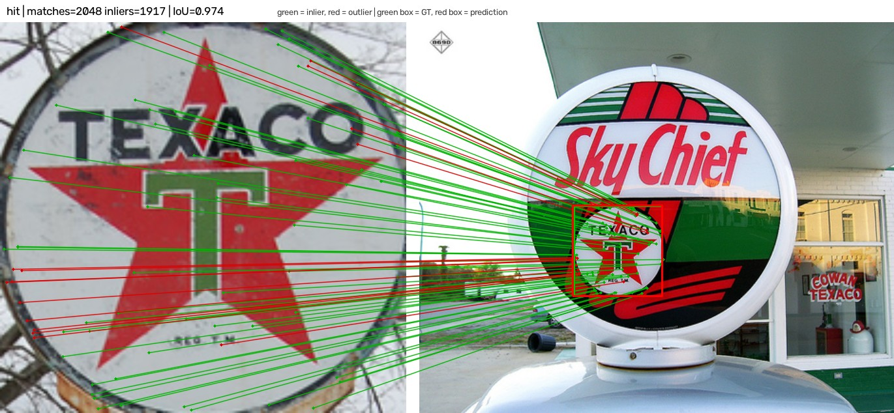

*Left: reference crop (input). Right: query image (input). Green box = GT, red
box = prediction; green lines = RANSAC inliers, red lines = outliers. This pair
has 2,048 matches, 1,917 inliers, IoU 0.974, inlier ratio 0.936, inlier coverage
0.852, and median reprojection error 1.28 px. Inlier ratio is inliers over
matches; coverage is the inlier hull over the reference crop area, so a low
value means the homography came from a small part of the logo; reprojection
error is the median inlier residual in query pixels. It is one pair from the
2,528; the aggregate numbers are below.*

| Model | Hit | AP@0.5 | Mean IoU | p50 | Params |
|---|---:|---:|---:|---:|---:|
| RoMa | **0.702** | **0.656** | **0.596** | 1,340 ms | 111.3 M |
| FlexGlue | 0.533 | 0.484 | 0.444 | 247 ms | 142.4 M |
| LoFTR | 0.461 | 0.420 | 0.408 | 85 ms | 11.6 M |
| SuperPoint + LightGlue | 0.451 | 0.420 | 0.389 | 79 ms | 13.2 M |
| SIFT | 0.413 | 0.406 | 0.352 | 48 ms | — |
| ALIKED + LightGlue | 0.354 | 0.332 | 0.308 | 76 ms | 12.6 M |
| AKAZE | 0.239 | 0.251 | 0.209 | 39 ms | — |
| ORB | 0.215 | 0.237 | 0.196 | 7 ms | — |

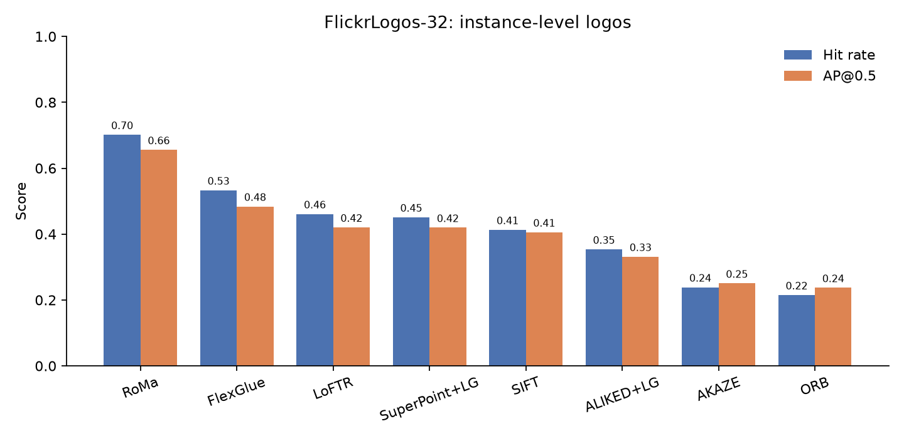

RoMa leads both hit rate and AP, with FlexGlue second. LoFTR and SuperPoint +
LightGlue are level on AP; SIFT follows; the classical ORB/AKAZE pair is at the
bottom. The same ordering is visible in mean IoU. On cost, RoMa is about 17×
slower than SuperPoint + LightGlue on this dataset, while FlexGlue sits between
them at roughly 3× the SuperPoint latency.

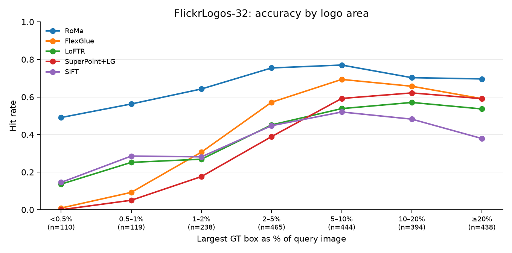

Accuracy rises with the logo’s share of the query image for every model. RoMa
is the flattest curve and the only model that stays near 0.5 at the smallest
bucket; FlexGlue climbs sharply with area; SuperPoint + LightGlue stays below
0.2 until logos reach about 2% of the query.

### 5.2 RPC

1,244 category-level pairs built from one public checkout-scene shard: a
reference product crop from one scene, other scenes containing the category as
queries, sampled negatives otherwise. The columns are the same box metrics as
above.

| Model | Hit | AP@0.5 | Mean IoU | p50 | Params |
|---|---:|---:|---:|---:|---:|
| FlexGlue | **0.463** | 0.366 | **0.421** | 253 ms | 142.4 M |
| SIFT | 0.451 | **0.371** | 0.410 | 156 ms | — |
| RoMa | 0.427 | 0.361 | 0.415 | 1,377 ms | 111.3 M |
| AKAZE | 0.400 | 0.312 | 0.363 | 168 ms | — |
| ORB | 0.312 | 0.299 | 0.302 | 16 ms | — |
| ALIKED + LightGlue | 0.208 | 0.208 | 0.212 | 106 ms | 12.6 M |
| SuperPoint + LightGlue | 0.199 | 0.175 | 0.213 | 108 ms | 13.2 M |
| LoFTR | 0.086 | 0.091 | 0.122 | 133 ms | 11.6 M |

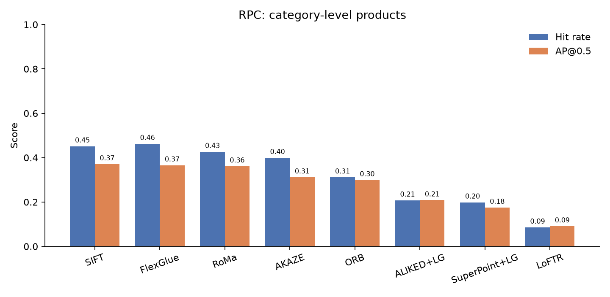

FlexGlue, SIFT, and RoMa form a close top group on AP; FlexGlue has the best
hit rate and mean IoU, SIFT the best AP. The learned sparse models and LoFTR
are clearly lower here. RPC is category-level, so this table is reported
separately from the instance-level datasets.

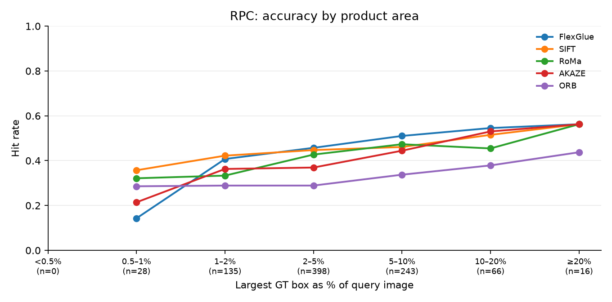

The area trend is weaker than on FlickrLogos-32: SIFT, FlexGlue, and RoMa stay
within a fairly narrow band across buckets, while the learned sparse models
remain low across the range.

### 5.3 HPatches

116 sequences and 580 pairs under the harness protocol: 2,048 keypoints,
raw-pixel coordinates, 3 px RANSAC. Matcher validation, not detection AP.
MMA@3 is match accuracy at 3 px, and HEA@3 the fraction of pairs whose mean
four-corner error is within 3 px; §2 gives the full definitions.

| Model | MMA@3 | HEA@3 |
|---|---:|---:|
| RoMa | **0.915** | **0.841** |
| FlexGlue | 0.881 | 0.791 |
| ALIKED + LightGlue | 0.864 | 0.778 |
| LoFTR | 0.847 | 0.762 |
| SuperPoint + LightGlue | 0.807 | 0.748 |
| AKAZE | 0.752 | 0.586 |
| SIFT | 0.734 | 0.705 |
| ORB | 0.720 | 0.529 |

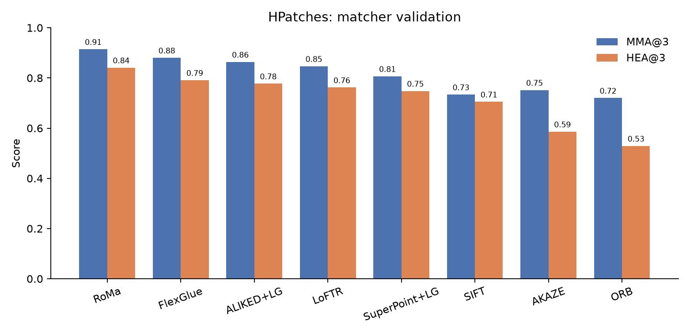

RoMa, ALIKED + LightGlue, and FlexGlue are the strongest group on HEA@3.
The RoMa row is the post-fix balanced-sampling rerun; the other rows are the
first full eight-model run, kept as the trace in §2.

### 5.4 PRW

PRW is full-frame person search: 932 identities, 11,816 frames, 34,304 boxes.
For a tractable first pass I used a 200-query subset: 5,881 pairs, 4,881
positives. The full manifest is 73,120 pairs; the subset is enough to test
whether local matching is viable at all.

| Model | Hit | AP@0.5 | Mean matches | Mean inliers | p50 |
|---|---:|---:|---:|---:|---:|
| RoMa | **0.115** | **0.056** | 2,048 | 280.7 | 1,499 ms |
| SuperPoint + LightGlue | 0.009 | 0.055 | 11.6 | 4.2 | 75 ms |
| LoFTR | 0.011 | 0.034 | 28.0 | 4.3 | 100 ms |
| ALIKED + LightGlue | 0.002 | 0.014 | 9.3 | 2.9 | 69 ms |
| AKAZE | 0.000 | 0.013 | 0.4 | 0.1 | 130 ms |
| FlexGlue | 0.003 | 0.010 | 1.9 | 0.8 | 291 ms |
| SIFT | 0.001 | 0.003 | 3.4 | 1.1 | 125 ms |
| ORB | 0.000 | 0.000 | 0.8 | 0.3 | 20 ms |

RoMa is the only model with a meaningful positive hit rate: 11.5%, versus at
most 1.1% for the rest. Its AP barely moves, though, because it predicts a box
on **1,000 of 1,000 negative pairs**. The mean inlier count is actually higher
on negatives (301.5) than on positives (280.7). With 2,048 dense
correspondences and a 3 px threshold, RANSAC almost always finds a dominant
plane — the background or another person — even when the reference person is
absent. Every pair gets one stage — hit, wrong box, no matches, too few
matches (RANSAC needs four), RANSAC failure, degenerate homography, or no
prediction. The stage counts make the same point: 4,197 wrong boxes, 561 hits,
123 degenerate homographies, and 1,000 false positives; there are no no-match
or RANSAC failures.

The first observation is size. PRW people are small: the median GT box is
**1.04%** of the query frame, 49% of positives are below 1%, and 77% are below
2%. The median reference crop is 78 × 220 px, and classical detectors find only
about 11 keypoints on an AKAZE crop, 32 on ORB, and 206 on SIFT.

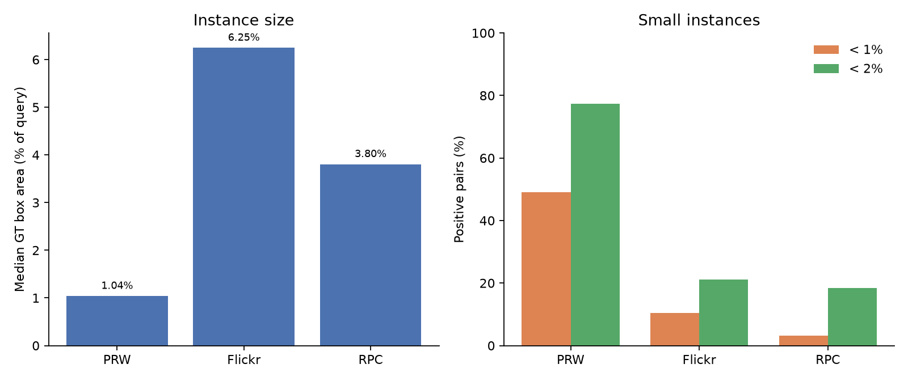

Size is not the whole story. The reference crop is already at the object scale:
its area is 1.15× the GT box on PRW, versus 16× on FlickrLogos-32 and 26× on
RPC. So this is not a reference-scale mismatch; the hard part is cross-camera
appearance, pose, and background.

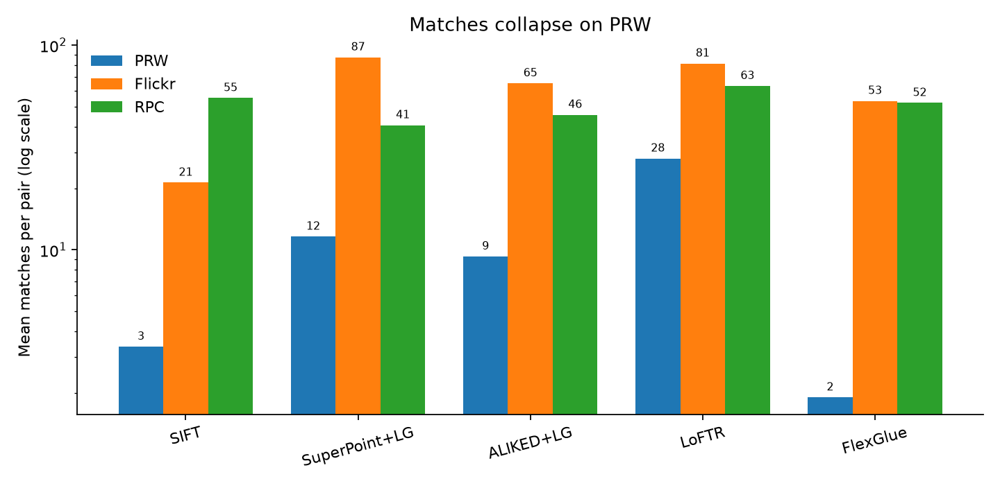

Outside RoMa, matches collapse by roughly 3–30× relative to the other datasets.
RoMa always emits 2,048 sampled correspondences by construction, so its match
count is not comparable; its failure is geometric. The stage breakdown shows
the two regimes: classical matchers mostly produce no matches or too few
matches; dense matchers produce correspondences but place the box on the wrong
person or background.

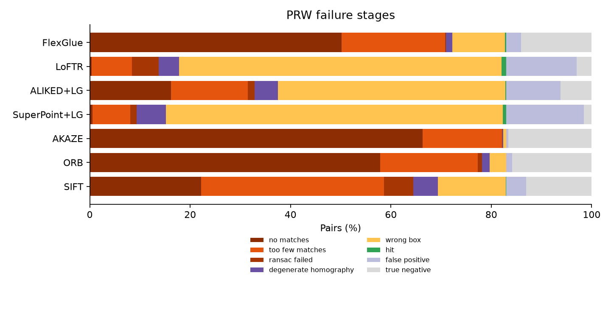

A typical SuperPoint + LightGlue pair makes the problem visible: 11 matches,
4 inliers, and a prediction on the wrong person. The inlier lines mostly follow
the background rather than the reference person.

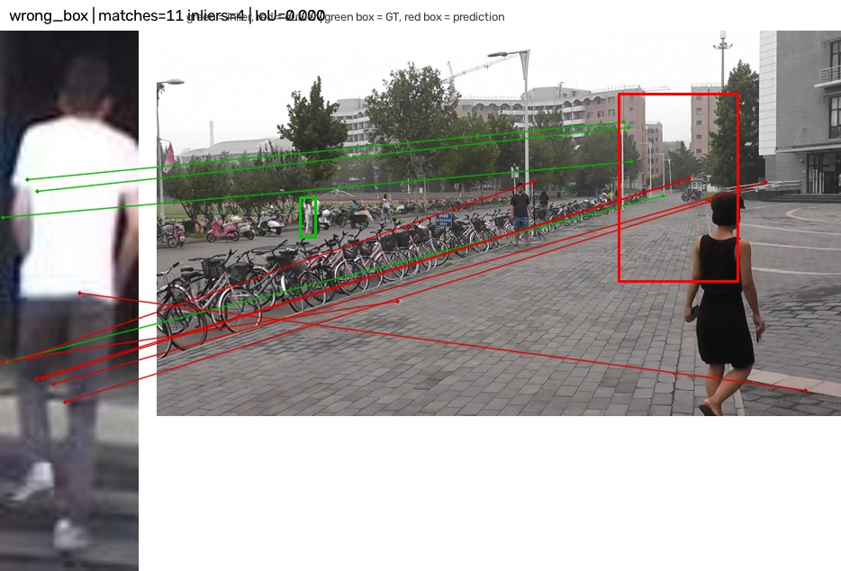

PRW is therefore a negative result for end-to-end local matching. RoMa shows
that a dense matcher can find more real positives, but without a verifier it
also accepts every negative pair, so AP remains near chance. The full 73k-pair
manifest was not run; the 200-query subset is enough to establish the failure
mode.

### 5.5 Cross-dataset view

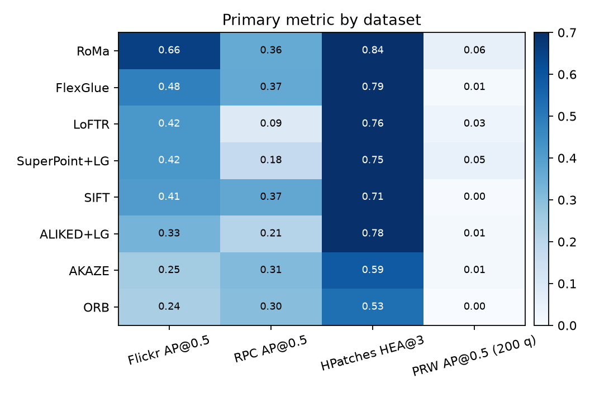

Read the matrix by column, not across datasets. RoMa leads FlickrLogos-32 and
HPatches; RPC is close between SIFT, FlexGlue, and RoMa; PRW is uniformly low.
FlexGlue is the best accuracy/cost compromise on the instance-level data, while
classical SIFT remains competitive on the category-level retail data.

Caveats: the FlickrLogos-32 split is project-specific (one reference per class,
cross-class negatives, no official P1/P2/P3 split); RPC uses one public shard
and is category-level; PRW uses a 200-query subset and is not directly
comparable to CUHK-style person-search numbers.

## 6. References

- Week 1 design and bibliography:
  [week1-devnotes.md](week1-devnotes.md)
- U. Efe, K. G. Ince, A. A. Alatan. 2021. **Effect of Parameter Optimization on
  Classical and Learning-based Image Matching Methods.** *ICCVW*.
  [arXiv](https://arxiv.org/abs/2108.08179)
- V. Balntas, K. Lenc, A. Vedaldi, K. Mikolajczyk. 2017. **HPatches: A Benchmark
  and Evaluation of Handcrafted and Learned Local Descriptors.** *CVPR*.
  [arXiv](https://arxiv.org/abs/1704.05939)
- P. Lindenberger, P.-E. Sarlin, M. Pollefeys. 2023. **LightGlue: Local Feature
  Matching at Light Speed.** *ICCV*. [arXiv](https://arxiv.org/abs/2306.13643)
- J. Sun, Z. Shen, Y. Wang, H. Bao, X. Zhou. 2021. **LoFTR: Detector-Free Local
  Feature Matching with Transformers.** *CVPR*.
  [arXiv](https://arxiv.org/abs/2104.00680)
- J. Edstedt, Q. Sun, G. Bökman, M. Wadenbäck, M. Felsberg. 2024. **RoMa:
  Robust Dense Feature Matching.** *CVPR*.
  [arXiv](https://arxiv.org/abs/2305.15404)
- P. Lindenberger, P.-E. Sarlin, O. Miksik, M. Pollefeys. 2026. **FlexGlue:
  Sparse-to-Dense Feature Matching and Visual Disambiguation.** *arXiv*.
  [arXiv](https://arxiv.org/abs/2610.32976)
- J. Lee, S. Kang, S. Yoo. 2026. **MV-RoMa: From Pairwise Matching into
  Multi-View Track Reconstruction.** *arXiv*.
  [arXiv](https://arxiv.org/abs/2603.27542)
