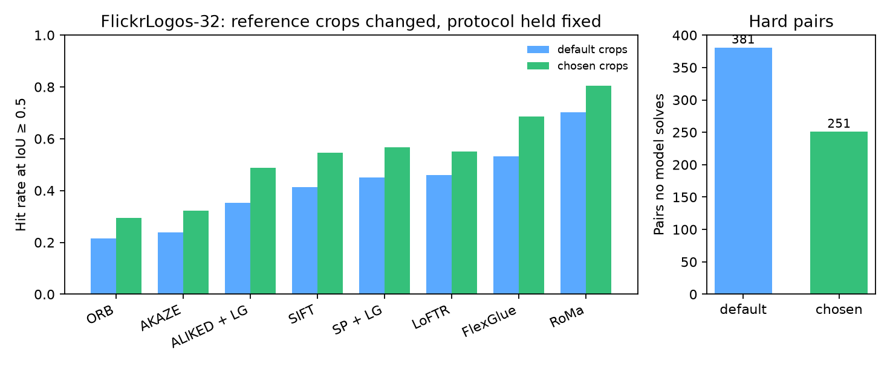
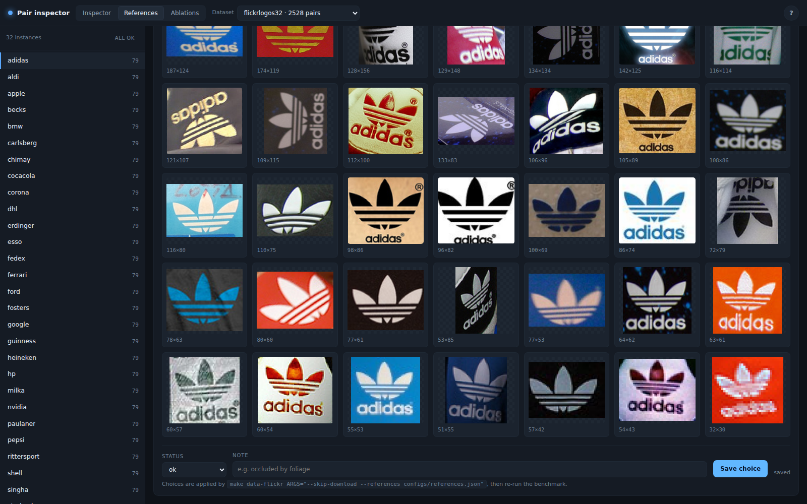

# Week 3 Devnotes: Diagnosis Tooling and Reference Quality

Weeks 1 and 2 answered "which matcher scores highest". This week changed the
question to "why does a given pair fail, and can I answer that repeatably". That
meant two kinds of work: a tool that shows what a matcher actually does on one
pair, and a measurement that separates a model failure from a data failure.

**The short version:** the benchmark's own inputs were part of the failure. Six
of the 32 FlickrLogos-32 classes have reference crops that are occluded, low
resolution, or not the mark at all. Those six hold 19% of the positive pairs and
48% of the pairs no model solves. Replacing 26 reference crops lifted every
matcher's hit rate by 15–38% relative and cut the unsolved pairs from 381 to 251.
The rest of the week went into tooling that makes that kind of claim checkable:
a pair inspector for the matcher's pre-RANSAC output, a reference picker that
writes the crop choice back into the manifest, an ablation queue, and a browser
smoke test so the tooling itself is verified rather than assumed.

## Metrics used in these notes

A *reference* is the crop of the instance being searched for; a *query* is the
image being searched; a *GT box* is the annotated instance box in the query. A
prediction is a **hit** when its box reaches IoU ≥ 0.5 with any GT box, and *hit
rate* is the fraction of positive pairs that hit. *AP@0.5* is 11-point
interpolated average precision over all pairs, ranked by RANSAC inlier count,
with predictions on negatives counted as false positives. A **hard pair** is a
positive pair that no benchmarked model solves.

## 1. What I built this week

- Reset the failure-analysis layer: removed the verifier-separability and
  wrong-box-anatomy additions, kept the stage and slice tables, per-class
  metrics, plots, and `make analyze`.
- Added model agreement: per-pair hit counts across the eight matchers, exported
  as `pair_agreement.csv` and `hard_pairs.csv`, with a Model agreement and a
  Hard pairs section in `analysis.md`.
- Reviewed all 32 FlickrLogos-32 reference crops by eye and tagged the defects.
- Added a reference picker to the UI, plus `check-refs` to verify that a choice
  reached the manifest.
- Built a pair inspector that draws the matcher's output before RANSAC, with
  reference-keypoint labels, residual arrows, keypoint display, Grad-CAM, and an
  occlusion sweep.
- Added an ablations tab: one-factor runs on a serial queue, with a runs table
  and deltas against a baseline.
- Added a browser smoke test (`make ui-smoke`) with 33 checks.

## 2. Model agreement shows where the ceiling is

Before touching references, the cheap question: how often does *any* model solve
a pair? For every positive pair, count how many of the eight matchers hit.


```text
FlickrLogos-32   381 of 2,208 positives solved by no model (17.3%)
                 solved by at least one: 0.827    best single model: 0.702
                 solved by all eight:    199

RPC              307 of 886 positives solved by no model (34.6%)
                 solved by at least one: 0.653    best single model: 0.463
                 solved by all eight:    42
```

Read as a ceiling: perfect per-pair model selection buys 12.5 points on
FlickrLogos-32 and 33 points on RPC. The RPC number is the more interesting one —
a third of its positive pairs are missed by all eight matchers, so on that
dataset the problem is not picking the right matcher.

The zero column of that histogram is what §3 and §4 are about.

## 3. The reference crops were part of the failure

The benchmark picks one reference per class: the image with the median logo
area. That rule is reproducible and arbitrary. Looking at the 32 crops:

| Class | Reference | Defect |
|---|---|---|
| carlsberg | 307 × 280 | wordmark behind foliage and glare, steep angle |
| pepsi | 169 × 158 | globe covered by overlaid graphics, edges cropped |
| apple | 103 × 125 | apple silhouette filled with Pepsi's globe — not the Apple mark |
| nvidia | 94 × 63 | low resolution, green on green, contrast 16.5 |
| hp | 115 × 120 | low resolution |
| ups | 57 × 67 | smallest crop in the dataset |

Hard-pair rates for those classes:

| Class | Defect | Hard | Positives | Rate |
|---|---|---:|---:|---:|
| carlsberg | occluded | 56 | 69 | 81% |
| nvidia | low-res, low contrast | 46 | 69 | 67% |
| pepsi | occluded | 36 | 69 | 52% |
| hp | low-res | 30 | 69 | 43% |
| apple | wrong content | 11 | 69 | 16% |
| ups | low-res | 4 | 69 | 6% |

Those six are 19% of positive pairs and 48% of the hard pairs, with a 44% hard
rate between them. Removing them from the accounting:

```text
all 32 classes     381 / 2208 = 17.3% hard
the six above      183 /  414 = 44.2% hard
everything else    198 / 1794 = 11.0% hard
```

Two things I got wrong on the way there, both worth recording.

**Photo statistics did not detect the problem.** I first screened the crops by
Laplacian variance and contrast. Carlsberg passed both — large, sharp,
high-contrast — while being almost unreadable. Occlusion and wrong content are
semantic defects; they need eyes.

**"Small" is not "bad".** UPS has the smallest crop in the dataset and a 6% hard
rate, because the mark is crisp and distinctive. NVIDIA is nearly twice the area
with a 67% hard rate. The binding property is usable information —
resolution × contrast × occlusion × whether the crop shows the instance at all.

There is a second-order effect: reference quality correlates with per-class hit
rate much more strongly for sparse matchers than for dense ones (Spearman across
the 32 classes, reference sharpness vs hit rate: FlexGlue +0.48, SIFT +0.39,
LoFTR +0.21, RoMa +0.09). Poor crops therefore flatter the dense models. The
comparison stays internally fair — every model sees the same crop — but it
measures robustness to bad input as well as matching quality.

## 4. Rerun with the chosen references

I replaced 26 of the 32 references and reran all eight models on the same 2,528
pairs, writing to `outputs/flickrlogos32-refs/` so the default-crop run in
`outputs/flickrlogos32/` stays intact as the ablation baseline.

Every model improved:

| Model | Hit (default → chosen) | AP@0.5 | Mean IoU |
|---|---|---|---|
| RoMa | 0.702 → **0.805** | 0.656 → **0.770** | 0.596 → 0.674 |
| FlexGlue | 0.533 → **0.686** | 0.484 → 0.585 | 0.444 → 0.569 |
| SuperPoint + LightGlue | 0.451 → 0.568 | 0.420 → 0.509 | 0.389 → 0.482 |
| LoFTR | 0.461 → 0.550 | 0.420 → 0.508 | 0.408 → 0.472 |
| SIFT | 0.413 → 0.546 | 0.406 → 0.482 | 0.352 → 0.463 |
| ALIKED + LightGlue | 0.354 → 0.489 | 0.332 → 0.424 | 0.308 → 0.412 |
| AKAZE | 0.239 → 0.323 | 0.251 → 0.315 | 0.209 → 0.289 |
| ORB | 0.215 → 0.295 | 0.237 → 0.245 | 0.196 → 0.269 |



```text
                        default crops   chosen crops
solved by no model      381             251      (−34%)
solved by all eight     199             375
best-case ceiling       0.827           0.886
```

The ranking is stable at the top and shifts once below it: LoFTR and
SuperPoint + LightGlue swap places, since LoFTR gains the least on hit rate
(+0.089). RoMa and FlexGlue keep first and second.

Per-class change, averaged across the eight models, is concentrated in the
swapped classes: bmw +0.411, corona +0.393, rittersport +0.324, fedex +0.261,
heineken +0.254. Three swaps went slightly backwards: ferrari −0.049, pepsi
−0.011, ford −0.004. No class became fully solved — carlsberg 56 → 46, pepsi
36 → 39, nvidia 46 → 30, hp 30 → 15, shell 7 → 15.

The BMW result corrects an earlier reading in this week's notes. I had called it
appearance-limited because its reference was large and crisp; with a different
crop RoMa goes from 0.217 to 0.812 on that class. Large and sharp is not the
same as representative.

Two caveats on the comparison. Swapping a reference also removes that image from
the queries and adds the old reference as one, so 52 pairs differ between the
runs (2 per swapped class); the other 2,476 are identical. And the two result
files record query paths differently — absolute in the first run, relative in
the second, because of how `--manifest` was passed — so they must be joined on
instance and file name, not on path.

## 5. Tooling

The week's other output is a local UI, `make ui`, served from `src/ui/` with no
new dependencies (stdlib HTTP server, vanilla JS).

### 5.1 Pair inspector


The point of this view is that it shows the matcher's answer **before RANSAC**:
every correspondence that survived the matcher's own filter, linked from the
reference crop to the query, with each query point labelled by the index of the
reference keypoint it matched. Annotations:

- **Links**, coloured by the RANSAC verdict, at an opacity that scales down with
  match count so dense pairs stay readable.
- **Residuals** — a dashed arrow from each matched point to where the estimated
  homography would put its reference point. Arrow length is the model's own
  geometric error, otherwise hidden by the inlier/outlier split.
- **Density** — matched-point occupancy per image, so "spread over the texture"
  and "locked onto one corner" are distinguishable.
- **Keypoints** — every detected keypoint, sized by detector response, with a
  top-k selector and per-image counts. Useful to see whether a region produced
  any features at all; disabled for dense matchers, which detect none.
- **Grad-CAM** — saliency of a chosen layer, with a selector listing every
  convolution and block (12 for SuperPoint, 26 for ALIKED). Available only for
  the LightGlue extractors: the vendored matcher detaches descriptors before
  matching, so the objective is the detector score plus a descriptor-norm term;
  LoFTR's features carry gradients but its confidence is detached, RoMa's
  `match()` is decorated with `torch.inference_mode()`, and FlexGlue runs custom
  kernels. Those three keep the occlusion sweep instead.
- **Occlusion** — blanks one cell of the reference, then one cell of the query,
  and reports where matches or confidence were lost. `grid² × 2` matcher runs,
  so it is a per-pair tool: about a second for SIFT, minutes for RoMa.

Match confidence is now retained too: `MatchResult.scores` carries each
matcher's own score (LightGlue match scores, LoFTR confidence, RoMa sampled
certainty, FlexGlue scores, `1 − d_best/d_second` for the classical ratio test),
and `MatchResult.keypoint_scores0/1` carries detector response. Benchmark output
is unchanged.

### 5.2 Reference picker



Every class image is offered as an alternative crop, with previews and the crop
currently in the manifest marked. Choosing one writes `configs/references.json`;
the manifest is rebuilt only on request:

```bash
make ui                                                     # pick crops
make check-refs                                             # 0 pending?
make data-flickr ARGS="--skip-download --references configs/references.json"
make check-refs                                             # applied
```

`check-refs` compares the selection against the manifest per instance and exits
non-zero while anything is pending. It exists because saving a choice changes
nothing on its own — the benchmark reads the manifest, not the picker — and
because a stale manifest looks identical to a fresh one from the UI. The server
rereads a manifest whose mtime changed and drops cached dumps, so a rebuild shows
up on the next request.

RPC is excluded from the picker: it has one crop per category, so there is
nothing to choose. The UI says so instead of offering a dead control.

### 5.3 Ablations

The third view runs one factor at a time (keypoints, RANSAC threshold, input
size, ratio) across a list of values on a serial queue, then shows each finished
run against a baseline with deltas for hit rate and AP. Every job records its
command, resolved config, and git commit beside its results, so a table row
traces back to the run that produced it. One GPU means one matcher at a time, and
the queue enforces that.

Views live in the URL (`#inspector`, `#references`, `#ablations`, plus
`dataset`, `model`, `pair`, `instance`, `help`), which is how the smoke test
drives the UI and how a specific pair can be linked.

### 5.4 The tooling is tested in a browser

`make ui-smoke` drives a running server through Chromium and checks what has
actually broken before: layer toggles, hover tooltip, click-to-pin, wheel zoom,
keypoint counts and top-k, Grad-CAM across layers, model switching, candidate
selection and save, the runs table and its baseline, the help panel, the dataset
switch, and one occlusion sweep. Console errors fail the run, and each view is
screenshotted to `outputs/ui/smoke/`. It currently passes 33/33.

## 6. What this changes about the benchmark's claims

Week 2's numbers remain valid for the default crops and remain internally
comparable — one protocol, one crop per class, eight matchers. What changes is
their interpretation:

- Absolute values are pessimistic: six of 32 classes carried reference defects.
- The 381-pair hard set is not a pure model-failure set. Roughly half of it is
  reference-limited, so a pipeline built to attack those pairs would have spent
  effort on causes it cannot fix.
- Reference choice is itself a protocol variable. Two runs now exist and are kept
  separately: `outputs/flickrlogos32-refs/` is the current result set, and
  `outputs/flickrlogos32/` is the reference-quality ablation.

The remaining 251 hard pairs are still concentrated in the same classes
(carlsberg, pepsi, nvidia, hp) and their median logo area is larger than the
dataset median, so what is left is not a size problem. That is the next
question, not one this week answers.

## 7. Open items

- **RPC reference mining**: the picker cannot offer alternatives there because
  the manifest stores one crop per category; the parquet shards hold the
  annotations needed to enumerate them.
- **Taxonomy of the remaining 251 pairs**: assign each to no-signal, ambiguous
  signal, weak geometry, or label error, using the oracle probes in
  `make diagnose` rather than judgement.
- **Grad-CAM for the dense matchers**: LoFTR is feasible with a differentiable
  surrogate; RoMa would describe its certainty field, not its sampled matches;
  FlexGlue depends on whether its kernels define a backward.
- **Aggregation across repeated runs**: `scripts/aggregate_runs.py` exists but the
  reference comparison is currently single-run per configuration.

## 8. References

- [FlickrLogos-32](https://www.uni-augsburg.de/en/fakultaet/fai/informatik/prof/mmc/research/datensatze/flickrlogos)
  and the [Voxel51/OpenLogo](https://huggingface.co/datasets/Voxel51/OpenLogo)
  mirror used for images and boxes.
- [LightGlue](https://arxiv.org/abs/2306.13643), [LoFTR](https://arxiv.org/abs/2104.00680),
  [RoMa](https://arxiv.org/abs/2305.15404), [FlexGlue](https://arxiv.org/abs/2610.32976)
  — the matchers the inspector renders.
- [Grad-CAM](https://arxiv.org/abs/1610.02391) — the saliency method behind the
  layer selector.
- [Playwright](https://playwright.dev/python/) — browser driving for the UI smoke
  test.
