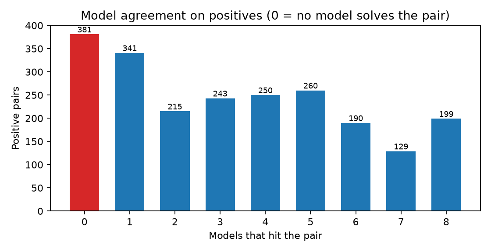
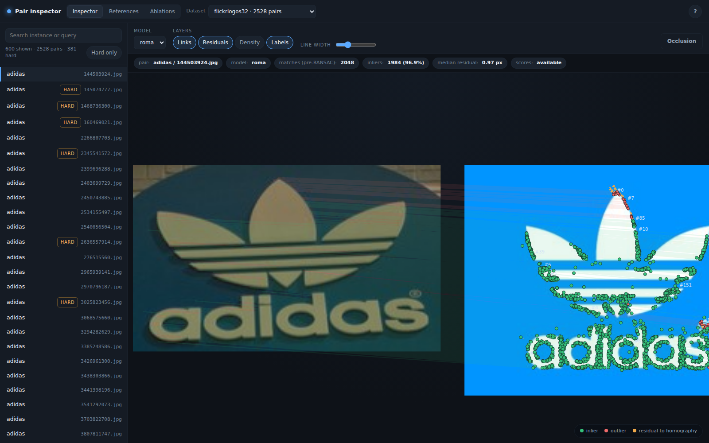

# Week 3 Devnotes: Diagnosis Tooling and Reference Quality

Working notes. This is the list of what was done, kept up to date as the week
runs; the write-up follows once the work is finished.

## Analysis

- Reset the failure-analysis layer: removed the verifier-separability and
  wrong-box-anatomy additions, kept stage/slice breakdowns, per-class metrics,
  plots, and `make analyze`.
- Added model agreement: `pair_agreement.csv`, `hard_pairs.csv`,
  `agreement_by_model_count.png`, plus Model agreement and Hard pairs sections
  in `analysis.md`.
- Measured the hard-pair sets: FlickrLogos-32 381 of 2,208 positives solved by
  no model, RPC 307 of 886.
- Renamed `logo_area_pct` to `object_area_pct` across the analysis layer, so the
  RPC reports say object size instead of logo size.
- Re-ran the analysis for FlickrLogos-32 and RPC.

## Reference quality

- Reviewed all 32 FlickrLogos-32 reference crops and found defects:
  - carlsberg: wordmark behind foliage and glare.
  - pepsi: globe covered by overlaid graphics.
  - apple: an apple-shaped silhouette filled with Pepsi's globe, not the mark.
  - nvidia: 94 × 63, green on green, contrast 16.5.
  - hp and ups: small crops.
- Measured hard-pair rates for those classes: carlsberg 56/69, nvidia 46/69,
  pepsi 36/69, hp 30/69, apple 11/69, ups 4/69.
- Found that Laplacian variance and contrast did not flag the bad crops:
  carlsberg scores high on both and is still unreadable.
- Found that crop size alone does not predict difficulty: ups has the smallest
  crop (57 × 67) and a 6% hard rate.

## Reference picker

- Added a References tab listing candidate crops per instance: all class images
  for FlickrLogos-32, a single crop for RPC.
- Saved choices to `configs/references.json`, with status and note per instance.
- Added `--references` to `scripts/prepare_flickrlogos32.py` to rebuild the
  manifest from the selection.
- Added `scripts/check_references.py` and `make check-refs`, which compares the
  selection against the manifest and exits non-zero while anything is pending.
- Moved the OpenLogo annotation loader into `src/utils/openlogo.py`, shared by
  the preparation script and the picker. Rebuilt manifest verified byte-identical.
- Excluded single-reference datasets from the picker (RPC), with a note in the
  view.
- Applied 26 chosen references and verified `check-refs` reports 26/26 applied.

## Rerun with the chosen references

- Rebuilt the manifest with the 26 chosen crops and verified 26/26 applied.
- Ran all eight models on the same 2,528 pairs into
  `outputs/flickrlogos32-refs/`, keeping `outputs/flickrlogos32/` as the
  default-crop baseline. Analysis regenerated for the new results.
- Hit rate moved up for every model:

  | Model | Default crops | Chosen crops | Δ |
  |---|---:|---:|---:|
  | RoMa | 0.702 | 0.805 | +0.104 |
  | FlexGlue | 0.533 | 0.686 | +0.153 |
  | ALIKED + LightGlue | 0.354 | 0.489 | +0.135 |
  | SuperPoint + LightGlue | 0.451 | 0.568 | +0.117 |
  | LoFTR | 0.461 | 0.550 | +0.089 |
  | SIFT | 0.413 | 0.546 | +0.133 |
  | AKAZE | 0.239 | 0.323 | +0.085 |
  | ORB | 0.215 | 0.295 | +0.080 |

- Pairs solved by no model fell from 381 to 251.
- Per-class changes were concentrated in the swapped classes: bmw +0.411 and
  corona +0.393 averaged across models, rittersport +0.324, fedex +0.261,
  heineken +0.254.
- Three swapped crops made things slightly worse: ferrari −0.049, pepsi −0.011,
  ford −0.004 (mean across models).
- No class went from hard to fully solved. carlsberg 56 → 46, pepsi 36 → 39,
  nvidia 46 → 30, hp 30 → 15, shell 7 → 15.
- The earlier read that bmw was appearance-limited rather than reference-limited
  was wrong: with a different crop RoMa went from 0.217 to 0.812 on that class.

## Pair inspector

- Added `src/ui/`, served by `main.py ui` and `make ui`.
- Draws the matcher's output before RANSAC: every correspondence linked from the
  reference crop to the query, each query point labelled with its reference
  keypoint index.
- Added residual arrows against the estimated homography, keypoint density
  overlays, and an occlusion sweep over the reference.
- Retained per-match confidence in `MatchResult.scores` for all eight matchers
  (LightGlue scores, LoFTR confidence, RoMa sampled certainty, FlexGlue scores,
  classical `1 − d_best/d_second`).
- Added model and dataset switching, hard-pairs filter, search, layer toggles,
  line-width control, help panel, and URL routing
  (`#inspector`, `#references`, `#ablations` plus dataset/model/pair/instance).

## Ablations

- Added an Ablations tab: one-factor runs (keypoints, RANSAC threshold, input
  size, ratio), serial queue, job log, and a runs table with deltas against a
  baseline.
- Each job writes its command, config, and git commit beside its results.

## Verification and fixes

- Added `scripts/ui_smoke.py` and `make ui-smoke`: drives the UI in Chromium,
  checks controls and console errors, saves screenshots. 25/25 checks pass.
- Fixed: `display: grid` overriding the `hidden` attribute, so all three views
  rendered at once.
- Fixed: boot loading a pair dump before switching tabs.
- Fixed: the ablation baseline choosing a 20-sample smoke run.
- Fixed: the smoke test writing real reference choices on every run.
- Fixed: the server caching the manifest at startup; it now reparses on change
  and has a Reload data button.
- Fixed: `prepare_flickrlogos32.py` silently doing nothing after a refactor
  removed its `__main__` block.
- Corrected the week-2 devlog and README, which credited the OOM killer for what
  was a full machine freeze and a restart.

## Figures

