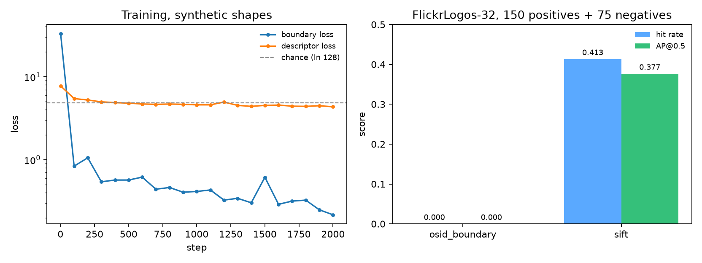

# Week 4 Devnotes: Starting the Model

Working notes. This is the list of what was done, kept up to date as the week
runs; the write-up follows once the work is finished.

## Scope

- Week 4 starts from the week-3 state: eight matchers, the harness, the
  inspector, and the reference sets — with no model of our own yet.
- Decision: week 4 is about creating a new model, not about improving the
  existing matchers or extending the diagnosis tooling.

## Model definition

- The model takes a pair of images — one query, one reference — and outputs
  keypoints on both plus the correspondences between them.
- The difference from existing matchers: keypoints must sit on the **outline of
  the object**, avoiding low-texture and non-descriptive regions.
- Training budget is deliberately undecided. The idea is validated by
  measurement first; training only happens if the measurement supports it.

## Design

- Wrote [`docs/model-design.md`](../model-design.md): problem statement, a
  falsifiable claim, the input/output contract, why boundary points should help,
  where the boundary signal comes from, three architecture options, training data
  requirements, Phase 0 measurements, evaluation, milestones, and risks.
- Claim under test: boundary-anchored keypoints give an object-consistent
  correspondence set and a better-conditioned geometry than
  repeatability-driven keypoints.
- Falsification: if restricting existing detectors to object regions does not
  improve the hard pairs, or boundary points are too unstable to match, the idea
  does not hold for this data.
- Motivating evidence recorded from the week-3 results:
  - 24% of the remaining hard pairs have predicted boxes 20× too large and
    centred a box-width away — background matches winning RANSAC.
  - 61% of the hard pairs are recoverable by correcting only scale and
    translation, the signature of an under-constrained geometry.
- Architecture options, in order of cost: (A) boundary-aware detector inside the
  existing pipeline, (B) joint boundary-supervised detector and descriptor,
  (C) end-to-end pair model. The plan assumes A first.
- Added metrics specific to the claim: outline precision and object-anchored
  match rate, reported alongside hit rate so a gain cannot come from something
  other than the stated idea.

## Model scaffold

- Adopted the `src/` layout and packaged the project as `osid`, so the model
  sits next to the benchmark it will be measured against.
- Built a per-image detector and descriptor: frozen DINOv3 ViT-S/16 backbone
  tapped at four layers, a fusion decoder to stride 4, a boundary head and a
  descriptor head, and local-maxima keypoint selection. Matching is a separate
  stage (`adapter.py`) so detection can be measured and cached on its own.
- 493k trainable parameters; the backbone stays frozen and in eval mode.
- Documented the architecture with a diagram and a stage → file table.
- Built a synthetic data generator of controlled difficulty: one filled shape on
  a flat background, with per-view size, rotation, perspective, contrast, blur,
  noise, and an optional shared background. Five shape families (polygon,
  rounded polygon, smooth blob, star, ellipse) over an 8-50% radius range, so
  the model sees curved and straight boundaries at many scales.
- Masks and correspondences are exact by construction: vertex reprojection under
  the homography is 1e-13 px, and mask-alignment IoU averages 0.980 (min 0.919,
  edge rasterisation on the smallest shapes).
- Added a contrast x blur grid so difficulty can be inspected directly rather
  than inferred from the parameters.
- Added the two losses for a first training attempt: a boundary heatmap target at
  decoder resolution with a penalty-reduced focal loss, and symmetric InfoNCE on
  descriptors at corresponding boundary points with a symmetry mask. Both are
  checked numerically (`python -m osid.model.losses`).
- Added the training loop: on-the-fly synthetic pairs, both views through the
  frozen backbone, boundary and descriptor losses, validation on a separate seed
  range, `heads.pt` and `history.json` in `outputs/train/`, and `make train`.
- First 60 steps: heatmap loss 182.8 -> 1.1, validation precision 0.72, recall
  0.35; descriptor loss 6.59 -> 4.69 against an ln 128 = 4.85 chance floor.
- Loaded those 60 steps of synthetic training and ran the detector on a real
  Flickr query: the boundary peaks land on the logo edges, not on the
  background. First evidence that the boundary prior transfers off polygons.
- Fixed a coordinate bug found by that test: keypoints were scaled with the
  backbone stride (16) instead of the decoder stride (4), so every point landed
  outside the image.

## First training run and evaluation

Trained 2,000 steps, batch 1, 128 boundary points, 448 px, frozen ViT-S:
493k trainable parameters, about 0.15 s per step.

### Synthetic data

| step | boundary loss | descriptor loss | precision | recall |
|---:|---:|---:|---:|---:|
| 1 | 33.1 | 7.75 | 0.05 | 0.07 |
| 200 | 1.06 | 5.24 | 0.90 | 0.45 |
| 1000 | 0.42 | 4.59 | 0.93 | 0.60 |
| 2000 | 0.22 | 4.35 | 0.96 | 0.62 |

The chance floor for the descriptor loss at 128 points is ln(128) = 4.85, so the
descriptor ended only 0.5 below chance.

Descriptor top-1 accuracy at the true corresponding points: **0.047** (0.082
when ambiguous negatives are excluded). Essentially chance.

### Real data

FlickrLogos-32, 150 positives and 75 negatives sampled from the manifest:

| model | hit | AP@0.5 | mean IoU | mean matches | mean inliers |
|---|---:|---:|---:|---:|---:|
| osid_boundary | 0.000 | 0.000 | 0.000 | 0.1 | 0.0 |
| SIFT | 0.413 | 0.377 | 0.375 | 20.7 | 10.1 |

Stages: `no_matches` 146 (65%), `true_negative` 75 (33%), `too_few_matches` 4
(2%). The failure is not a wrong box; matching produces almost nothing.

### What the metrics now show

The first evaluation exposed a gap in the training log itself, so the loop was
changed before any further training. It now reports descriptor top-1 accuracy
against its chance floor, the share of negatives the symmetry mask suppresses,
precision and recall at the threshold inference actually uses, on both views,
and the median keypoint count; `best.pt` is kept on validation F1.

Re-scoring the existing 2,000-step checkpoint on a fresh validation seed:

| Metric | Value |
|---|---:|
| Descriptor loss | 3.36 (chance at 128 points: 4.85) |
| Descriptor top-1 accuracy | 0.066 (chance 0.008) |
| Negatives suppressed by the symmetry mask | 8% |
| Heatmap precision at the 0.3 threshold | 0.95 |
| Heatmap recall at the 0.3 threshold | 0.74 |
| Median keypoints per image | 56 |

Two corrections to the earlier reading. The detector is better than the 0.5
threshold suggested: 0.95 precision and 0.74 recall at the operating point,
against 0.96 / 0.62 measured at 0.5. And the descriptor is weak but not empty:
top-1 is 8x chance, so some positional signal exists; it is simply far from
usable. The symmetry mask was ruled out as a cause, suppressing 8% of negatives
rather than most of them.

### Detector alone, on real images

The benchmark result above measures the matcher, not the detector. Isolating the
detector on 60 real queries:

| Measurement | Median | Mean |
|---|---:|---:|
| Keypoints per query | 140.5 | 149.3 |
| Keypoints inside the GT box | 0.104 | 0.222 |
| Gradient percentile at keypoints | 0.744 | 0.735 |
| SIFT gradient percentile (same images) | 0.813 | 0.774 |
| Random-pixel gradient percentile | 0.502 | 0.476 |

Two readings. On the positive side, keypoints sit on edges well above chance
(0.74 against 0.50 for random pixels), and close to SIFT (0.81), so the
boundary prior survives the synthetic-to-real gap.

On the negative side, only 10% of keypoints fall inside the annotated instance
box. The detector is class-agnostic: it fires on every strong edge in the frame,
and the object is one edge system among many. In the synthetic data the shape
was the only edge, so this never showed up. It means a matcher does not face a
clean correspondence set with a few outliers; it faces roughly nine distractors
per object point, which is a much harder rejection problem than the synthetic
setup ever exercised.

It also explains the low keypoint count: `top_k` is 512 but the 0.3 threshold and
local-maximum test keep only about 140 points per frame.

### Diagnosis

The detector works: 238 keypoints on a reference crop, 151 on a query, and
boundary precision 0.96 on synthetic. The descriptor is the bottleneck.
Descriptors at different boundary points are nearly identical — within-image
p90 cosine 0.96, cross-view best 0.980 against a runner-up of 0.979 (margin
1.01) — so mutual nearest neighbour plus a ratio test rejects everything.

The cause is resolution and signal, not training length: a stride-4 descriptor
summarises a 4 px neighbourhood that looks the same at adjacent keypoints along
an edge, and a 1×1 head over DINOv3 features has no positional cue to separate
them. InfoNCE is then asked to distinguish points that are genuinely
indistinguishable at that scale.

Candidate fixes, cheapest first: pick keypoints at high curvature rather than
uniformly along the boundary; raise the descriptor to stride 2; add a projection
head with per-image centering; and relax the matcher to many-to-many plus
RANSAC, which would show whether any signal exists before retraining.

## Second run: stride 2, centering, distractors

The first run's descriptor sat at chance, so the descriptor path changed before
another training session:

- descriptor grid at stride 2 instead of 4;
- per-image centering before normalisation, since DINOv3 patch features share a
  large common direction;
- 512 boundary points instead of 128, temperature 0.05;
- 2 distractor shapes per frame, with 64 of their boundary points entering the
  InfoNCE denominator;
- validation now logs top-1 accuracy, the ignored-negative share, precision and
  recall at the operating threshold on both views, and the keypoint count;
  `best.pt` is kept on validation F1.

1,000 steps, about two minutes:

| step | boundary | descriptor | P | R | top-1 | chance | kp |
|---:|---:|---:|---:|---:|---:|---:|---:|
| 1 | 82.6 | 14.9 | 0.02 | 0.67 | 0.003 | 0.002 | 512 |
| 300 | 0.34 | 6.32 | 0.74 | 0.89 | 0.003 | 0.002 | 151 |
| 1000 | 0.17 | 6.32 | 0.87 | 0.80 | 0.002 | 0.002 | 142 |

The detector improved: precision and recall are now balanced at 0.87 / 0.80,
against 0.96 / 0.62 at stride 4, and the keypoint count is 142 instead of 56
because the finer grid keeps more peaks.

The descriptor did not. Top-1 stays at chance for the whole run, and the loss
does not move below the ln(576) = 6.36 floor (512 points plus 64 distractor
negatives).

## Real data, second checkpoint

| matching | hit | AP@0.5 | matches | inliers | stages |
|---|---:|---:|---:|---:|---|
| mutual NN + ratio | 0.000 | 0.000 | 0.0 | 0.0 | no_matches 67% |
| many-to-many + RANSAC | 0.000 | 0.000 | 20.2 | 20.2 | degenerate homography 57% |

Switching to many-to-many does produce candidate matches, so the descriptor is
not emitting identical vectors; but the geometry they imply is degenerate, so
the candidates are wrong rather than merely sparse.

Detector alone, same checkpoint: 107 keypoints per query, gradient percentile
0.766 against SIFT's 0.796, and 6% inside the annotated box.

## What the second run says about the descriptor

Not "train longer". The descriptor is at chance *in distribution*, which means
the task it was given is not learnable from its input. On a flat-coloured shape
against a flat background, every point along a smooth edge has the same local
appearance: same contrast, same two colours, same gradient direction. Only
curvature distinguishes points, and a 1×1 head over smooth features cannot
represent that.

Two ways to make the task learnable, both structural:

- **give the shapes local appearance variation** — texture, gradients, or a
  pattern inside the shape, so two boundary points look different;
- **make descriptors context-aware** — a patch descriptor from a larger
  neighbourhood, which encodes where along the boundary it sits.

The first is a generator change and the cheaper experiment; the second is a
model change. Either is a better use of the next training session than another
1,000 steps of the current setup.

## Frozen DINOv3 tokens as descriptors

Given that DINOv3 embeddings had worked well on another project, the descriptor
head was swapped for frozen backbone tokens: last-block patch tokens, bilinearly
upsampled to the prediction grid, centred, L2-normalised, with no descriptor head
and no descriptor loss.

| Test | Result |
|---|---|
| Synthetic top-1 at true correspondences (256 points) | 0.011 (chance 0.004) |
| Real pairs, mutual NN + ratio | 0.000 hit, 0 matches |
| Real pairs, many-to-many + RANSAC | 0.000 hit, degenerate homography on 48% |
| Best/second similarity margin, 448 px | 1.006 |
| Same margin at 896 px | 1.003 |
| Within-image cosine, real pair | 0.994 mean, 0.999 p90 |

Doubling the resolution did not help, so the ambiguity is not spatial. At 1/16
patch resolution, many keypoints share or nearly share a token, and after
centering the remaining variation is small compared with the noise: the best
match is barely better than the second best, which is exactly what the ratio
test rejects.

As a global verifier the same backbone is also weak: CLS cosine similarity
separates positives from negatives at AUC 0.646 on 225 pairs (positives 0.618,
negatives 0.568).

Conclusion: raw DINOv3 features are not usable as per-pixel descriptors or as a
zero-shot verifier here. The two standard ways to use them are a learned
projection trained contrastively on top of the frozen features, or a learned
matcher over the token grid (which is what RoMa does with DINOv2 and a matching
head). Either keeps the backbone frozen and trains something small, which is a
better bet than either the 1x1 head or raw tokens.

## Phase 0 (not started)

- Pseudo-masks from the reference boxes, then measure where current keypoints
  land: on the instance, on its boundary, or in the background.
- Repeat for the matches RANSAC accepts versus rejects.
- Oracle region filtering on the 251 hard pairs, with the GT box on the query as
  the upper bound.
- Boundary-band filtering, which is the model's actual operating point.

## Open items

- Run Phase 0 measurement 1 and decide whether the premise survives.
- Decide whether pseudo-masks come from GrabCut (no new dependency) or a
  promptable segmentation model.
- Decide the training scope after Phase 0: instance-level only, or instance plus
  category.
