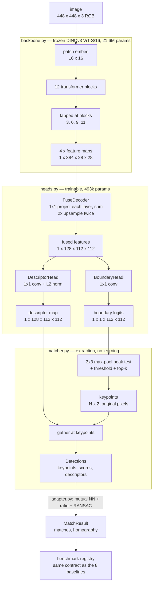

# osid/model

A per-image detector and descriptor: one image in, keypoints and descriptors
out. Matching is not part of the model — that keeps detection measurable,
cacheable, and independent of whichever matcher you put on top.

Status: scaffold. The pipeline runs end to end, but the decoder and heads are
untrained, so the output is structurally correct and semantically meaningless
until Phase 0 in [`docs/model-design.md`](../../../docs/model-design.md) says the
premise is worth training.

## Architecture

One image in, keypoints and descriptors out. Matching is the dashed part: it
belongs to `adapter.py`, not to the model.



The solid path is the model. The dotted path is what the benchmark needs and
what you replace when you want a learned matcher instead of a geometric one.

### Tensor shapes

```text
input                     H x W x 3            resized to 448 on the long side
patch embed               h/16 x w/16          stride 16, so 28 x 28 at 448
tapped layers (4)         28 x 28 x 384        blocks 3, 6, 9, 11
fused (sum)               28 x 28 x 128        1x1 projections, summed
decoder output            112 x 112 x 128      two 2x upsampling stages, stride 4
boundary logits           112 x 112 x 1        sigmoid -> probability
descriptor map            112 x 112 x 128      L2-normalised per cell
keypoints                 N x 2                N <= top_k (512), original pixels
descriptors               N x 128              gathered from the map
```

### Where each part lives

| Stage | File | Function or class |
|---|---|---|
| resize, normalise, patch embed, blocks | `backbone.py` | `Dinov3Backbone.forward`, `_prepare` |
| layer fusion and upsampling | `heads.py` | `FuseDecoder.forward` |
| boundary logits | `heads.py` | `BoundaryHead.forward` |
| descriptors | `heads.py` | `DescriptorHead.forward` |
| peak test, threshold, top-k | `matcher.py` | `extract_keypoints` |
| detection set | `detector.py` | `DetectorDescriptor.detect` → `Detections` |
| matching for the benchmark | `adapter.py` | `BenchmarkAdapter.match`, `match_detections` |
| matching rules | `matcher.py` | `match_descriptors` |
| knobs | `config.py` | `ModelConfig` |

## Reading order

| File | What it does | Where to change things |
|---|---|---|
| `config.py` | every knob, in one dataclass | backbone name, input size, tapped layers, widths, top-k, thresholds |
| `backbone.py` | frozen DINOv3 ViT-S/16, multi-layer features, resize + normalise, feature→pixel mapping | swap the backbone, change which blocks are tapped |
| `heads.py` | fusion decoder to stride 4, boundary head, descriptor head | decoder depth, widths, head design |
| `detector.py` | the model: `detect(image) -> Detections` | how keypoints are selected, what is returned |
| `matcher.py` | matching utilities: mutual NN, ratio test | matching rules, when you want them shared |
| `adapter.py` | benchmark adapter: detect both images, then match | the matcher used for benchmarking, homography settings |
| `synth.py` | synthetic pairs: object pasted into two backgrounds, with masks and an exact homography | placement, degradation, occlusion, backgrounds |
| `__main__.py` | run one image and write an overlay | the quickest way to see the model work |

## Run it

```bash
uv run python -m osid.model --index 0                 # query image from the manifest
uv run python -m osid.model --index 0 --reference     # reference crop instead
uv run python -m osid.model --image photo.jpg --top-k 256
```

It prints keypoint and descriptor statistics and writes `outputs/model-demo.png`
with points sized and coloured by boundary score.

## Synthetic data

`synth.py` produces pairs of a filled polygon on a flat background, with each
knob set independently per view: number of sides, scale, rotation, perspective,
contrast against the background, Gaussian blur, and additive noise. Backgrounds
can differ between views, so the only shared signal is the shape.

```bash
uv run python -m osid.model.synth --samples 6             # contact sheet
uv run python -m osid.model.synth --samples 20 --check    # label sanity
uv run python -m osid.model.synth --grid                  # contrast × blur grid
```

`--check` warps view A's mask through the generated homography and compares it
with view B's, reporting mask IoU **0.988 mean / 0.981 min** over 20 samples:
resampling error, not label error. Polygons are kept fully inside the canvas,
since clipping one view but not the other would invalidate the correspondence
for the clipped part.

What this generator is for: isolating capability. If the model cannot find a
high-contrast polygon and match it under blur and noise, it will not do better
on a logo photographed in the wild. What it cannot provide is realism —
appearance change, texture, occlusion by other objects, real backgrounds. That
is the next generator, not this one.

## Why per-image

- **The claim is a detector property.** "Points sit on the outline" is measurable
  on one image against a pseudo-mask. Inside a pair model it would be entangled
  with matching, and failures could not be attributed.
- **Training without pairs.** Boundary supervision comes from pseudo-masks;
  descriptor supervision from two augmented views of the same image. Every image
  becomes training signal, which matters with ~2.2k Flickr crops.
- **Caching.** One reference against 69 queries costs 70 forwards, not 138, and
  the features are reusable across every matcher variant and ablation.
- **Matching is an ablation.** Mutual NN + ratio today; optimal transport or a
  learned matcher later, with the detector untouched.

The cost: ambiguity that only cross-image context can resolve — repeated logos,
sibling products — is out of reach until a learned matcher is added.

## Benchmark compatibility

`BenchmarkAdapter.match(reference, query)` implements the same `MatchResult`
contract as the eight baselines, so the model can be registered in
`osid.benchmark.registry.MODELS` once trained. It also exposes
`match_detections(detections0, detections1)`, which skips the backbone when the
same image is matched many times.
